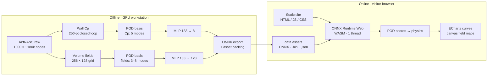

# Data-Driven Airfoil Aerodynamic Surrogate and Inverse Design

English | [简体中文](README.zh-CN.md)

<div align="center">

### Compress 1000 CFD solutions into 17 MB. Predict pressure and flow in milliseconds, in the browser.

**2026 Jiangsu Province "AI + Science" Competition · Graduate Division · Entry G012 · Team PCDLab**


[Live demo](https://ygrf0816.github.io/airfrans-MOR-demo/) · [Demo video](https://www.bilibili.com/video/BV1YSpu6gEbm/) · [Architecture](#architecture) · [Integration standards](#integration-standards) · [Source code](code/)

</div>

> An interactive demo of a reduced-order aerodynamic surrogate: 1000 two-dimensional airfoil RANS solutions are compressed into a few POD coordinates, a ~0.3 M-parameter network predicts those coordinates in milliseconds, and the same representation drives explainability analysis and constrained inverse design. All inference runs on the visitor's machine — no backend, no GPU, no dataset download.

<details>
<summary><kbd>Contents</kbd></summary>

- [Project overview](#project-overview)
  - [Background](#background)
  - [What it does](#what-it-does)
  - [Highlights](#highlights)
- [Demo video](#demo-video)
- [Architecture](#architecture)
  - [Data pipeline](#data-pipeline)
  - [Runtime and modules](#runtime-and-modules)
  - [Application layer](#application-layer)
- [Integration standards](#integration-standards)
  - [Asset contract](#asset-contract)
  - [ONNX interface](#onnx-interface)
  - [Geometry and field conventions](#geometry-and-field-conventions)
  - [Hosting requirements](#hosting-requirements)
  - [Optional LLM endpoint](#optional-llm-endpoint)
  - [Conformance checks](#conformance-checks)
- [Quick start](#quick-start)
- [Repository layout](#repository-layout)
- [License and citation](#license-and-citation)

</details>

---

## Project overview

### Background

The cross-section of a fan blade, a wind-turbine blade or an aircraft wing is an *airfoil*. Its shape decides how much lift it produces at a given inflow speed and angle of attack. The traditional loop is *change the shape → run CFD → read the numbers → change it again*, and one two-dimensional RANS case costs minutes to hours. A design study needs thousands of evaluations, so compute — not ideas — is the bottleneck.

The dataset used here is [AirfRANS](https://github.com/Extrality/AirfRANS): 1000 high-fidelity two-dimensional airfoil RANS solutions (SST turbulence model), split into 489 four-digit and 511 five-digit NACA geometries, 14.3 GB on disk. The dataset is only the *source of data*. The problem this project attacks is the **"reduction → surrogate → inverse design" chain itself**.

### What it does

1. **Reduce.** Every solution is projected onto a POD basis: a pressure curve needs 5 modes for 99% energy, a volume field 3 (pressure) to 8 (velocity). The full dataset shrinks from **14.3 GB to 16.98 MB** — about **885:1**.
2. **Surrogate.** A four-layer MLP takes 133 inputs (5 inflow scalars + a 128-dim geometry curve) and predicts POD coordinates: 8 for the pressure curve, 4 × 32 = 128 for the four volume fields. About **0.3 M parameters**, exported to ONNX.
3. **Serve.** A static site runs those ONNX models through **ONNX Runtime Web (WebAssembly)** inside the visitor's browser. Five pages: reduction, forward prediction, explainability, inverse design, results.
4. **Invert.** The same fast surrogate is used backwards: a constrained multi-objective search for a better airfoil, and a study of how far a pressure distribution can be inverted into a shape.

### Highlights

| # | Contribution | Evidence |
|---|---|---|
| 1 | **Reduction instead of point-wise regression.** Predicting a handful of POD coordinates beats regressing every mesh point, at a fraction of the size. | On the aligned protocol, the body-fitted volume-field error is **0.20–0.23×** the official single-pass GNN error (~5× better); model ≈ 0.3 M parameters, runs in a browser tab. |
| 2 | **Four chains, one representation.** Forward prediction, explainability, inverse design and pressure inversion all operate on the same POD coordinates instead of four unrelated models. | `code/prediction`, `code/explain`, `code/inversion` share one basis; the demo uses the same numbers. |
| 3 | **Constrained multi-objective inverse design.** Maximise lift at the design point while minimising loss across the operating angle band, under local-Mach and separation constraints. | Lift coefficient **1.347–1.351** at 8° vs **1.146** for the best real airfoil in the same database; **101 Pareto solutions** beat it; three seeds agree within 0.3%. |
| 4 | **Quantified non-uniqueness of the inverse problem.** A pressure curve can be fitted below the model's own error floor while the recovered shape is visibly different. | "Pressure fits well" does **not** mean "the shape was recovered" — true camber normal, recovered camber reflex. A reusable caution for any pressure-to-shape inversion. |
| 5 | **Zero-install demonstration.** The whole site is static; all inference is client-side. | ~58 MB site, no backend, no GPU, no dataset download. |

Accuracy summary on the four official splits (per-sample relative L2 error, 5 repeated runs): pressure curve **0.23–0.44** (0.311 on `full`), against a mean-field baseline 0.93–1.12, a ridge-regression baseline 0.57–0.86, and a POD truncation floor of 0.048.

---

## Demo video

| Content | Link |
|---|---|
| **Demo video (Bilibili)** | <https://www.bilibili.com/video/BV1YSpu6gEbm/> |
| Backup copy (Quark Drive, code `TUsy`) | <https://pan.quark.cn/s/53ef366cdbf7> |
| Live interactive demo | <https://ygrf0816.github.io/airfrans-MOR-demo/> |

The video is the submission material for this entry: it walks the problem, the three-step method (reduce → surrogate → invert) and then drives the live site page by page — reduction, forward prediction, explainability, inverse design, results. If the Bilibili link is unavailable in your region, use the backup copy; if you only want to try it yourself, open the live demo directly (desktop Chrome or Edge recommended).

---

## Architecture

The system has an offline half that produces assets and an online half that consumes them. They meet at a single contract: the files in `site/data/`.



### Data pipeline

| Stage | What happens | Where |
|---|---|---|
| 1. Reduce | Per-sample wall pressure is sampled on a closed 256-point arc-length loop (anchored at the leading edge); volume fields are interpolated onto a common 256 × 128 Cartesian grid with an airfoil-interior mask (31 066 valid cells). POD bases are computed per quantity. | `code/mor/`, `code/prediction/workstation_pod.py` |
| 2. Train | A four-layer MLP (width 256) predicts POD coordinates from 133 z-scored inputs. Four official splits (`full`, `scarce`, `reynolds`, `aoa`) are trained and evaluated; baselines and the POD truncation floor are reported alongside. | `code/prediction/` |
| 3. Export | Models are exported to ONNX (opset 17) and verified against PyTorch element-wise with a combined tolerance; bases, statistics, sample indices and case fields are packed into the asset set. | `tools/export_onnx.py`, `tools/make_web_data.py` |
| 4. Serve | Vite builds the frontend; the build output plus `site/data/` is published as a static site. | `source/`, `.github/workflows/pages.yml` |

### Runtime and modules

| Module | Responsibility | Key files |
|---|---|---|
| `code/prediction` | Training, evaluation, official-protocol comparison, ONNX export support | `train_B_field.py`, `train_B_transformer.py`, `official_metrics.py`, `geometry_input.py` |
| `code/mor` | Dataset audit, parameter decoding, POD reduction and reconstruction checks | `p2_pod_wallcp.py`, `p3_volume_pod.py`, `wall_force.py` |
| `code/explain` | Explainability data and figures (four geometry components, global vs local sensitivity) | `plot_report_figs.py`, `plot_field_local.py` |
| `code/inversion` | Reachability, multi-objective search, weight verification, pressure inversion | `ga_design.py`, `verify_weight_local.py`, `field_cases.py` |
| `code/station` | Thin wrapper for running jobs on the remote workstation | `remote.py` |
| `tools` | Asset export, consistency verification, packaging | `make_web_data.py`, `export_onnx.py`, `verify_demo_assets.py` |
| `source` | Frontend (React 19 + TypeScript, ECharts / canvas) | `src/lib/models.ts`, `src/lib/fieldmodel.ts`, `src/pages/*` |
| `site` | Built site and exported assets — the deployed artifact | `site/data/*` |

### Application layer

| Page | Purpose |
|---|---|
| Reduction | How 1000 solutions collapse into a dozen numbers; rank truncation, projection, upload your own curve |
| Forward prediction | Change geometry and inflow, watch the pressure curve and flow field update |
| Explainability | Which geometry component matters, how much, and over which chord range |
| Inverse design | Natural-language goal → candidate shapes, with constraint pass/fail; optional online LLM, local rule mode by default |
| Results | Pareto front, three-seed convergence, dataset health |

---

## Integration standards

Everything below is the contract between the offline exporter, the frontend and any third-party consumer. If you replace the models, keep the formats.

### Asset contract

All assets live under `site/data/` and are served as plain files. **Every binary is little-endian float32** and is meant to be mapped directly with `Float32Array` — never re-encoded as JSON number arrays (3× larger, slower to parse).

| File | Type | Shape / size | Required |
|---|---|---|---|
| `manifest.json` | JSON | asset index (`entries[]` with `name`, `kind`, `bytes`, `required`) | yes |
| `b_cp.onnx` | ONNX | pressure-curve surrogate | yes |
| `b_field.onnx` | ONNX | volume-field surrogate | yes |
| `cp_basis.json` | JSON | POD basis + z-score statistics for the pressure model | yes |
| `field_basis.bin` / `field_basis.json` | float32 / JSON | POD basis of the four volume fields, and its metadata | yes |
| `grid.json` | JSON | 256 × 128 grid extent and airfoil mask | yes |
| `samples.json` | JSON | 1000-sample index (name, inflow, AoA, family, lift) | yes |
| `samples_cp.bin` | float32 | `[1000, 256]` wall pressure curves | yes |
| `samples_geom.bin` | float32 | `[1000, 128]` geometry curves | yes |
| `samples_alpha.bin` | float32 | `[1000, 136]` = 8 pressure coords + 128 field coords | yes |
| `cases_field.bin` / `cases_field.json` | float32 / JSON | four fields of seven worked cases, sliced by `blocks` | yes |
| `results.json` | JSON | Pareto fronts, seed histories, dataset health, official benchmark table | yes |
| `figs/*` | webp / svg / jpg | gallery figures and `figs/index.json` captions | yes |

`kind` in `manifest.json` is limited to `model`, `basis`, `grid`, `samples`, `cases`, `results`, `image`.

### ONNX interface

| Model | Input | Output | Meaning of output |
|---|---|---|---|
| `b_cp.onnx` | `x` float32 `[1, 133]` | `alpha` float32 `[1, 8]` | POD coordinates of the pressure curve |
| `b_field.onnx` | `x` float32 `[1, 133]` | `alpha` float32 `[1, 128]` | 4 fields × 32 POD coordinates |

Input layout: the first 5 values are z-scored inflow scalars, the remaining 128 are the z-scored geometry curve. **Z-score statistics must be taken from `cp_basis.json` (pressure model) or `field_basis.json` (field model)** — they are not interchangeable.

Reconstruction, done in JavaScript (negligible cost):

```
cp[i]   = Σ_k alpha[k] · phi[i][k] + mu[i]                 # k = 0..7
field_k = Σ_j alpha[32k + j] · phi[k][j] + mu[k]           # k = 0..3 (u, v, p, nu_t)
```

The 31 066 valid field values are then written into the 128 × 256 mask in row-major order.

### Geometry and field conventions

These are the traps that silently corrupt results; they are listed here because any integrator will hit them.

| Item | Convention |
|---|---|
| Pressure curve | **Closed loop along the airfoil contour**, normalised arc length `s ∈ [0, 1]`, 256 points. `s = 0` and `s = 1` are both the leading edge, `s ≈ 0.5` is the trailing edge. Treating `s` as a chordwise axis produces wrong conclusions. |
| Geometry vector (128) | Cosine-spaced chordwise stations. Indices `0–63` are the **upper** surface `y/c`, `64–127` the lower surface. **Index 0 is the trailing edge**, index 63 the leading edge — reversed with respect to intuition. |
| Inflow scalars (5) | `[U∞, AoA, 0.15·L, T/100, round(Q)]` — camber enters as `0.15·L`, not `L`. |
| Volume fields | `u`, `v`, `p`, `nu_t` on a 256 × 128 grid, `x ∈ [-2.16, 4.23]`, `y ∈ [-1.65, 1.65]`, row-major `(ny, nx)`. |
| Units | `Cp = p / (0.5·U∞²)` (already divided by dynamic pressure). Values from the binary basis are in normalised space; multiply by the standard deviation and add the mean from `field_basis.json` to get physical units. |
| Max-thickness position | A discrete quantity: only 5 distinct values exist in the dataset, and the five-digit family uses 3 of them. Never differentiate or continuously perturb it. |

### Hosting requirements

| Requirement | Why |
|---|---|
| Serve `.wasm` as `application/wasm` | ONNX Runtime Web does not fall back to `ArrayBuffer` loading and fails silently otherwise. `serve.py` pins the MIME type; Python's `http.server` below 3.9 and many minimal servers get it wrong. GitHub Pages is correct out of the box. |
| No `Cross-Origin-Opener-Policy` / `Cross-Origin-Embedder-Policy` needed | The models run with `ort.env.wasm.numThreads = 1`, so no `SharedArrayBuffer`. This is what makes plain static hosting sufficient (GitHub Pages cannot send custom headers). A multi-threaded build would require COOP/COEP and therefore a different host. |
| Relative base path | Vite is configured with `base: './'`; assets resolve relative to the document, so the site runs unchanged at `https://<user>.github.io/<repo>/`. |
| Hash routing | Pages are selected by `#hash`; no 404 rewrite rules or SPA fallback are required. |
| Browser support | WebAssembly SIMD: Chrome 91+, Edge 91+, Firefox 89+, Safari 16.4+. |

### Optional LLM endpoint

The inverse-design page can call an OpenAI-compatible chat endpoint. It is strictly optional — with no configuration the page runs a local rule-based mode and the badge says so.

| Field | Meaning |
|---|---|
| `endpoint` | Base URL of an OpenAI-compatible API; the page posts to `{endpoint}/chat/completions` |
| `model` | Model name passed through to the provider |
| `apiKey` | Bearer token |

The key is held in **memory only** — never written to `localStorage`, `sessionStorage`, IndexedDB, cookies or a file; it disappears when the tab is closed or reloaded. No default key exists anywhere in the code or repository. The training and inverse-design pipelines never call an external endpoint.

### Conformance checks

Self-checks ship with the repository and pass/fail by fixed output strings, so they can gate a build:

| Command | Pass criterion |
|---|---|
| `node source/scripts/check-geom.mjs` | `PASS all 12 items < 1e-9` — browser geometry vs the official generator, point by point |
| `node source/scripts/check-proxies.mjs` | `PROXY_CHECK_OK` — lift integration, local Mach proxy, separation proxy |
| `node source/scripts/check-vtp.mjs` | `VTP_CHECK_OK` — `.vtp` parsing vs the Python reference, to 5e-7 |
| `python tools/verify_demo_assets.py` | 25-item asset audit: presence, byte sizes, array shapes, value ranges |
| ONNX export check | `|ONNX − PyTorch| ≤ 1e-4 + 1e-3·|PyTorch|` element-wise, at least 8 samples covering both families |

---

## Quick start

### Try it

Open <https://ygrf0816.github.io/airfrans-MOR-demo/> in desktop Chrome or Edge. Nothing to install.

### Run locally

Do **not** open `site/index.html` by double-clicking: the `file://` protocol blocks the model and data fetches and the page stays blank. Use the bundled server:

```bash
python serve.py            # http://127.0.0.1:8080
python serve.py 9000       # custom port
```

`serve.py` only pins the MIME types that matter (`.wasm`, `.onnx`, `.bin`); it needs nothing beyond the standard library.

### Rebuild the site

```bash
cd source
npm ci
npm run build        # output in source/dist; copy over site/ and keep site/data/
```

### Regenerate assets

Asset export needs the upstream dataset and a GPU; the training and search code is in [`code/`](code/README.md). Paths inside those scripts were written for the author's workstation and must be adjusted first.

---

## Repository layout

| Path | Content |
|---|---|
| `code/` | Core code: surrogate training, inverse design, explainability, reduction (see [`code/README.md`](code/README.md)) |
| `source/` | Frontend source (Vite + React 19 + TypeScript) |
| `site/` | Built static site and exported assets — this is what gets deployed |
| `tools/` | Asset export, verification and packaging scripts |
| `docs/` | Plan, data contract, UI design, development log, upstream-code reuse list |
| `serve.py` | Local static server with correct MIME types |
| `LICENSE` / `DATA_LICENSE.md` | MIT for code, ODbL for the derived assets |

Not included: the 14.3 GB upstream dataset, training checkpoints (`.pth`), and the reports/paper of the submission package.

---

## License and citation

- **Code** (`code/`, `source/`, `tools/`, `serve.py`): MIT — see [`LICENSE`](LICENSE). Geometry generation, data loading and force-coefficient conventions reference or reuse the official AirfRANS implementation; the itemised list is in [`docs/06_airfrans_reuse.md`](docs/06_airfrans_reuse.md).
- **Data and model assets** (`site/data/`): derivative of the AirfRANS dataset, distributed under the upstream ODbL v1.0 — see [`DATA_LICENSE.md`](DATA_LICENSE.md).

If you use this project or the dataset, please cite:

```bibtex
@inproceedings{bonnet2022airfrans,
  title={Airf{RANS}: High Fidelity Computational Fluid Dynamics Dataset for Approximating Reynolds-Averaged Navier-Stokes Solutions},
  author={Florent Bonnet and Jocelyn Ahmed Mazari and Paola Cinnella and Patrick Gallinari},
  booktitle={Thirty-sixth Conference on Neural Information Processing Systems Datasets and Benchmarks Track},
  year={2022},
  url={https://arxiv.org/abs/2212.07564}
}
```
