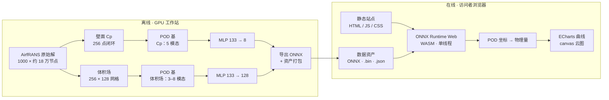

# 数据驱动的翼型气动代理与反向设计

[English](README.md) | 简体中文

<div align="center">

### 把 1000 条 CFD 解压成 17 MB，在浏览器里毫秒级预测压力与流场

**2026 年江苏省「人工智能 + 科学」大赛 · 硕博组 · 参赛编号 G012 · 队伍 PCDLab**


[在线体验](https://ygrf0816.github.io/airfrans-MOR-demo/) · [演示视频](https://www.bilibili.com/video/BV1YSpu6gEbm/) · [架构介绍](#架构介绍) · [集成标准](#集成标准) · [核心代码](code/)

</div>

> 一个降阶气动代理模型的交互式演示：1000 条二维翼型 RANS 数值解被压成十几个 POD 坐标，约 30 万参数的小网络毫秒级预测这些坐标，同一套表示同时支撑可解释性分析与带约束的反向设计。全部推理在访问者的浏览器里完成——没有后端、不需要显卡、不用下载数据集。

<details>
<summary><kbd>目录</kbd></summary>

- [项目介绍](#项目介绍)
  - [项目背景](#项目背景)
  - [核心功能](#核心功能)
  - [创新亮点](#创新亮点)
- [视频介绍](#视频介绍)
- [架构介绍](#架构介绍)
  - [数据管线](#数据管线)
  - [运行时与核心模块](#运行时与核心模块)
  - [应用层](#应用层)
- [集成标准](#集成标准)
  - [资产契约](#资产契约)
  - [ONNX 接口](#onnx-接口)
  - [几何与场量口径](#几何与场量口径)
  - [托管要求](#托管要求)
  - [可选的大模型接口](#可选的大模型接口)
  - [一致性核对](#一致性核对)
- [快速开始](#快速开始)
- [仓库结构](#仓库结构)
- [许可与引用](#许可与引用)

</details>

---

## 项目介绍

### 项目背景

风机叶片、螺旋桨、飞机机翼的横截面都是**翼型**。翼型形状决定了它在给定来流速度与攻角下能产生多大升力。传统设计流程是「改形状 → 跑 CFD → 看指标 → 再改」，而一条二维 RANS 算例要几分钟到几小时。一次设计研究要评估几千个方案，瓶颈不在想法，而在算力。

本项目使用 [AirfRANS](https://github.com/Extrality/AirfRANS) 数据集：1000 条高保真二维翼型 RANS 数值解（SST 湍流模型），四位 NACA 489 条、五位 NACA 511 条，原始数据 14.3 GB。**数据集只是数据来源**，本项目要解决的是「**降维 → 代理 → 反向设计**」这条链路本身。

### 核心功能

1. **降维**：每条解都投影到 POD 基上——压力曲线 5 个模态即覆盖 99% 能量，体积场压力 3 个、速度 8 个。整份数据从 **14.3 GB 压到 16.98 MB**，约 **885:1**。
2. **代理**：四层 MLP 接 133 维输入（5 个来流标量 + 128 维几何曲线），输出 POD 坐标：压力曲线 8 个，四个体积场 4 × 32 = 128 个。约 **30 万参数**，导出为 ONNX。
3. **展示**：纯静态站点在访问者浏览器里用 **ONNX Runtime Web（WebAssembly）** 跑这些 ONNX 模型。五个页面：降维演示、前向预测、可解释性分析、反向设计、成果总览。
4. **反推**：把同一个快速代理反过来用——带约束的多目标搜索找一个更好的翼型，并研究「压力分布能反推到什么程度」。

### 创新亮点

| # | 贡献 | 证据 |
|---|---|---|
| 1 | **用降维替代逐点回归。** 预测少量 POD 坐标，比回归每个网格点更准、模型小得多。 | 同口径下，贴体体积场误差是官方逐点图神经网络单轮的 **0.20–0.23 倍**（好约 5 倍）；模型约 30 万参数，可在浏览器标签页里跑。 |
| 2 | **四条链路共用一套表示。** 前向预测、可解释性、反向设计、压力反演都跑在同一组 POD 坐标上，而不是四个互不相干的模型。 | `code/prediction`、`code/explain`、`code/inversion` 共用同一套基；演示页用的也是同一批数字。 |
| 3 | **带约束的多目标反向设计。** 设计点升力最大，同时工作攻角带内损失最小，并施加局部马赫数与分离代理两条硬约束。 | 8° 攻角升力系数 **1.347–1.351**，同工况数据库最优真实翼型 **1.146**；**101 个前沿解**优于它；三个随机种子相差 0.3% 以内。 |
| 4 | **量化了反问题的不唯一性。** 压力曲线可以拟合到低于模型自身误差下限，但反推出来的形状明显不同。 | 「压力拟合好」**不等于**「形状还原正确」——真实是正常弯、反推是反弯。对任何「压力→形状」反演都适用的警示。 |
| 5 | **零安装演示。** 整站静态，全部推理在客户端。 | 站点约 58 MB，无后端、无显卡、无需下载数据集。 |

四个官方划分上的精度（逐样本相对 L2 误差，5 次重复）：压力曲线 **0.23–0.44**（`full` 为 0.311）；对照均值场基线 0.93–1.12、岭回归基线 0.57–0.86、POD 截断理论下限 0.048。

---

## 视频介绍

| 内容 | 链接 |
|---|---|
| **演示视频（B 站）** | <https://www.bilibili.com/video/BV1YSpu6gEbm/> |
| 备用地址（夸克网盘，提取码 `TUsy`） | <https://pan.quark.cn/s/53ef366cdbf7> |
| 在线交互演示 | <https://ygrf0816.github.io/airfrans-MOR-demo/> |

视频是本参赛作品的演示材料：先讲问题，再讲三步方法（降维 → 代理 → 反推），然后逐页实拍线上站点——降维演示、前向预测、可解释性分析、反向设计、成果总览。若 B 站链接在所在地区不可用，请使用网盘备用地址；只想自己试的话，直接打开在线演示即可（建议用电脑版 Chrome 或 Edge）。

---

## 架构介绍

系统分「离线产出资产」和「在线消费资产」两半，两半之间只有一个契约：`site/data/` 下的文件。



### 数据管线

| 阶段 | 做什么 | 位置 |
|---|---|---|
| 1 降维 | 逐样本壁面压力按**沿轮廓的归一化弧长**取 256 点闭环（前缘锚定）；体积场插值到公共 256 × 128 笛卡尔网格，用并集掩膜挖掉翼型内部（有效格 31 066 个）。逐场量计算 POD 基。 | `code/mor/`、`code/prediction/workstation_pod.py` |
| 2 训练 | 四层 MLP（宽 256）从 133 维 z-score 输入预测 POD 坐标。四个官方划分（`full`、`scarce`、`reynolds`、`aoa`）分别训练与评估，并同时报告基线与 POD 截断下限。 | `code/prediction/` |
| 3 导出 | 模型导出为 ONNX（opset 17），用合并容差与 PyTorch 逐元素比对；基、统计量、样本索引与案例场打包成资产。 | `tools/export_onnx.py`、`tools/make_web_data.py` |
| 4 发布 | Vite 构建前端，产物连同 `site/data/` 作为静态站点发布。 | `source/`、`.github/workflows/pages.yml` |

### 运行时与核心模块

| 模块 | 负责什么 | 关键文件 |
|---|---|---|
| `code/prediction` | 训练、评估、官方口径对照、ONNX 导出支撑 | `train_B_field.py`、`train_B_transformer.py`、`official_metrics.py`、`geometry_input.py` |
| `code/mor` | 数据集体检、参数解码、POD 降维与重建核对 | `p2_pod_wallcp.py`、`p3_volume_pod.py`、`wall_force.py` |
| `code/explain` | 可解释性数据与作图（几何四分量、全局与局部敏感性） | `plot_report_figs.py`、`plot_field_local.py` |
| `code/inversion` | 可达性、多目标搜索、权重核对、压力反演 | `ga_design.py`、`verify_weight_local.py`、`field_cases.py` |
| `code/station` | 远端工作站调用的薄封装 | `remote.py` |
| `tools` | 资产导出、一致性核对、打包 | `make_web_data.py`、`export_onnx.py`、`verify_demo_assets.py` |
| `source` | 前端（React 19 + TypeScript，ECharts / canvas） | `src/lib/models.ts`、`src/lib/fieldmodel.ts`、`src/pages/*` |
| `site` | 构建产物与导出资产——真正被部署的东西 | `site/data/*` |

### 应用层

| 页面 | 作用 |
|---|---|
| 降维演示 | 一千条数据怎么用十几个数字概括；秩截断、投影、上传自己的曲线 |
| 前向预测 | 改几何与来流参数，压力曲线与流场云图即时更新 |
| 可解释性分析 | 哪个几何分量重要、影响多少、落在哪一段弦长 |
| 反向设计 | 自然语言目标 → 候选翼型，附约束通过情况；可选在线大模型，默认本地规则模式 |
| 成果总览 | 折中前沿、三个种子的收敛、数据集体检 |

---

## 集成标准

以下是离线导出端、前端与任何第三方消费者之间的契约。若替换模型，请保持这些格式。

### 资产契约

全部资产位于 `site/data/`，按普通文件提供。**所有二进制一律小端 float32**，用 `Float32Array` 直接映射——不要转成 JSON 数字数组（体积翻三倍、解析更慢）。

| 文件 | 类型 | 形状 / 规模 | 必需 |
|---|---|---|---|
| `manifest.json` | JSON | 资产清单（`entries[]`，含 `name`、`kind`、`bytes`、`required`） | 是 |
| `b_cp.onnx` | ONNX | 压力曲线代理模型 | 是 |
| `b_field.onnx` | ONNX | 体积流场代理模型 | 是 |
| `cp_basis.json` | JSON | 压力曲线模型的 POD 基与 z-score 统计量 | 是 |
| `field_basis.bin` / `field_basis.json` | float32 / JSON | 四个体积场的 POD 基与元信息 | 是 |
| `grid.json` | JSON | 256 × 128 网格范围与翼型掩膜 | 是 |
| `samples.json` | JSON | 1000 条样本索引（名称、来流、攻角、族别、升力） | 是 |
| `samples_cp.bin` | float32 | `[1000, 256]` 壁面压力曲线 | 是 |
| `samples_geom.bin` | float32 | `[1000, 128]` 几何曲线 | 是 |
| `samples_alpha.bin` | float32 | `[1000, 136]` = 8 个压力坐标 + 128 个流场坐标 | 是 |
| `cases_field.bin` / `cases_field.json` | float32 / JSON | 七个案例的四个流场，按 `blocks` 切块 | 是 |
| `results.json` | JSON | 折中前沿、种子收敛、数据集体检、官方基准表 | 是 |
| `figs/*` | webp / svg / jpg | 画廊图片与 `figs/index.json` 图注 | 是 |

`manifest.json` 里的 `kind` 只取 `model`、`basis`、`grid`、`samples`、`cases`、`results`、`image`。

### ONNX 接口

| 模型 | 输入 | 输出 | 输出含义 |
|---|---|---|---|
| `b_cp.onnx` | `x` float32 `[1, 133]` | `alpha` float32 `[1, 8]` | 压力曲线的 POD 坐标 |
| `b_field.onnx` | `x` float32 `[1, 133]` | `alpha` float32 `[1, 128]` | 4 个场 × 32 个 POD 坐标 |

输入排布：前 5 维是 z-score 后的来流标量，后 128 维是 z-score 后的几何曲线。**z-score 统计量必须取自 `cp_basis.json`（压力模型）或 `field_basis.json`（流场模型）**，两者不可混用。

还原在 JavaScript 里完成（开销可忽略）：

```
cp[i]   = Σ_k alpha[k] · phi[i][k] + mu[i]                 # k = 0..7
field_k = Σ_j alpha[32k + j] · phi[k][j] + mu[k]           # k = 0..3（u、v、p、nu_t）
```

再把 31 066 个有效值按行优先填进 128 × 256 的掩膜。

### 几何与场量口径

以下几条会静默地把结果搞错，任何接入方都会撞上。

| 项 | 口径 |
|---|---|
| 压力曲线 | **沿翼型轮廓的闭环**，归一化弧长 `s ∈ [0, 1]`，256 点。`s = 0` 与 `s = 1` 都是前缘，`s ≈ 0.5` 是后缘。把 `s` 当弦向横轴会得出错误结论。 |
| 几何向量（128 维） | 余弦加密的弦向站位。下标 `0–63` 是**上**表面 `y/c`，`64–127` 是下表面。**下标 0 在后缘**、63 在前缘——顺序与直觉相反。 |
| 来流标量（5 维） | `[U∞, 攻角, 0.15·L, T/100, round(Q)]`——弯度以 `0.15·L` 进入，不是 `L`。 |
| 体积场 | `u`、`v`、`p`、`nu_t` 在 256 × 128 网格上，`x ∈ [-2.16, 4.23]`、`y ∈ [-1.65, 1.65]`，行优先 `(ny, nx)`。 |
| 单位 | `Cp = p / (0.5·U∞²)`（已除过动压）。二进制基里存的是归一化空间的值，还原物理量要先乘标准差再加均值（统计量见 `field_basis.json`）。 |
| 最大厚度位置 | 离散量：全库只有 5 个取值，五位族只用其中 3 个。不可求导、不可连续扰动。 |

### 托管要求

| 要求 | 原因 |
|---|---|
| `.wasm` 必须以 `application/wasm` 发送 | ONNX Runtime Web 不会退回 `ArrayBuffer` 加载，会静默失败。`serve.py` 里写死了 MIME；Python 3.9 以前的 `http.server` 和不少极简服务器会发错。GitHub Pages 本身是正确的。 |
| 不需要 `Cross-Origin-Opener-Policy` / `Cross-Origin-Embedder-Policy` | 模型以 `ort.env.wasm.numThreads = 1` 运行，不用 `SharedArrayBuffer`。这正是普通静态托管（GitHub Pages 无法自定义响应头）就够用的原因。若改用多线程构建，则需要 COOP/COEP，也就得换托管方。 |
| 相对基础路径 | Vite 配置为 `base: './'`，资产相对文档解析，因此放在 `https://<user>.github.io/<repo>/` 下无需改动。 |
| 哈希路由 | 页面由 `#hash` 切换，不需要 404 重写或 SPA 回退规则。 |
| 浏览器支持 | 需要 WebAssembly SIMD：Chrome 91+、Edge 91+、Firefox 89+、Safari 16.4+。 |

### 可选的大模型接口

反向设计页可以调用 OpenAI 兼容的对话接口。它是**完全可选**的——不填配置时页面走本地规则模式，角标会标明当前模式。

| 字段 | 含义 |
|---|---|
| `endpoint` | OpenAI 兼容 API 的基础地址；页面向 `{endpoint}/chat/completions` 发请求 |
| `model` | 传给服务方的模型名 |
| `apiKey` | Bearer 令牌 |

密钥**只存在内存**——不写 `localStorage`、`sessionStorage`、IndexedDB、Cookie 或文件，关闭或刷新标签页即丢失。代码与仓库里不存在任何默认密钥。训练与反向设计流程不调用任何外部接口。

### 一致性核对

自检脚本随仓库提供，以固定输出字符串判定通过，可直接当构建门禁：

| 命令 | 通过判据 |
|---|---|
| `node source/scripts/check-geom.mjs` | `PASS all 12 items < 1e-9`——浏览器端几何与官方生成器逐点比对 |
| `node source/scripts/check-proxies.mjs` | `PROXY_CHECK_OK`——升力积分、局部马赫代理、分离代理 |
| `node source/scripts/check-vtp.mjs` | `VTP_CHECK_OK`——`.vtp` 解析与 Python 参考实现比对到 5e-7 |
| `python tools/verify_demo_assets.py` | 25 项资产核对：齐全性、字节数、数组形状、取值范围 |
| ONNX 导出核对 | `|ONNX − PyTorch| ≤ 1e-4 + 1e-3·|PyTorch|` 逐元素成立，至少 8 条样本且覆盖两族 |

---

## 快速开始

### 直接体验

用电脑版 Chrome 或 Edge 打开 <https://ygrf0816.github.io/airfrans-MOR-demo/>，不用装任何东西。

### 本地运行

**不要双击 `site/index.html`**：`file://` 协议会拦掉模型与数据请求，页面会是一片空白。用随附的服务器：

```bash
python serve.py            # http://127.0.0.1:8080
python serve.py 9000       # 指定端口
```

`serve.py` 只写死了关键的几类 MIME（`.wasm`、`.onnx`、`.bin`），除标准库外不需要任何依赖。

### 重新构建站点

```bash
cd source
npm ci
npm run build        # 产物在 source/dist，覆盖到 site/ 并保留 site/data/
```

### 重新生成资产

资产导出需要上游数据集与 GPU；训练与搜索代码在 [`code/`](code/README.md)。这些脚本里的路径是按作者工作站写的，跑之前要先改成自己的。

---

## 仓库结构

| 路径 | 内容 |
|---|---|
| `code/` | 核心代码：代理模型训练、反向设计、可解释性、降维（见 [`code/README.md`](code/README.md)） |
| `source/` | 前端源码（Vite + React 19 + TypeScript） |
| `site/` | 构建好的静态站点与导出资产——真正部署的就是这个目录 |
| `tools/` | 资产导出、核对与打包脚本 |
| `docs/` | 作品计划、数据契约、界面设计、开发记录、官方代码复用清单 |
| `serve.py` | 本地静态服务器（MIME 类型正确） |
| `LICENSE` / `DATA_LICENSE.md` | 代码 MIT；派生资产 ODbL |

不包含：14.3 GB 上游数据集、训练权重（`.pth`）、以及提交包里的报告与论文。

---

## 许可与引用

- **代码**（`code/`、`source/`、`tools/`、`serve.py`）：MIT，见 [`LICENSE`](LICENSE)。其中几何生成、数据加载与力系数口径参照或直接使用了官方 AirfRANS 实现，逐条清单见 [`docs/06_airfrans_reuse.md`](docs/06_airfrans_reuse.md)。
- **数据与模型资产**（`site/data/`）：AirfRANS 数据集的衍生作品，沿用上游 ODbL v1.0，见 [`DATA_LICENSE.md`](DATA_LICENSE.md)。

使用本项目或数据集，请引用：

```bibtex
@inproceedings{bonnet2022airfrans,
  title={Airf{RANS}: High Fidelity Computational Fluid Dynamics Dataset for Approximating Reynolds-Averaged Navier-Stokes Solutions},
  author={Florent Bonnet and Jocelyn Ahmed Mazari and Paola Cinnella and Patrick Gallinari},
  booktitle={Thirty-sixth Conference on Neural Information Processing Systems Datasets and Benchmarks Track},
  year={2022},
  url={https://arxiv.org/abs/2212.07564}
}
```
